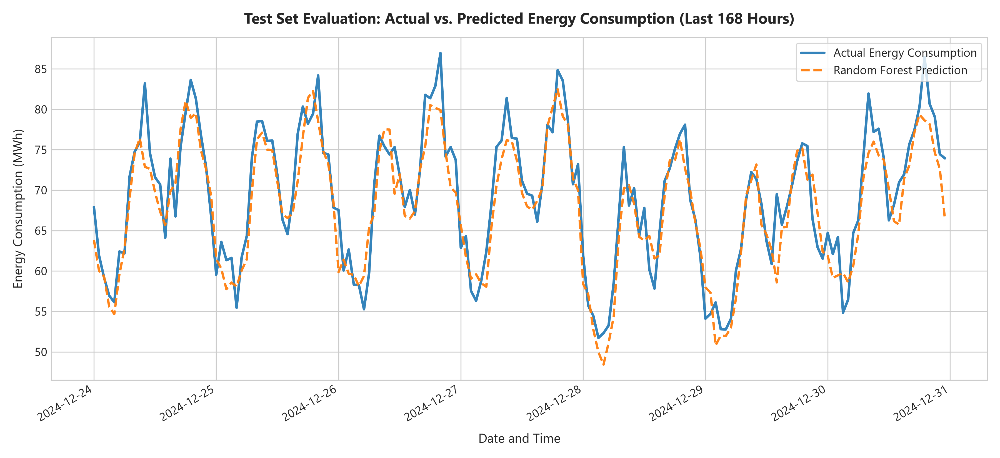
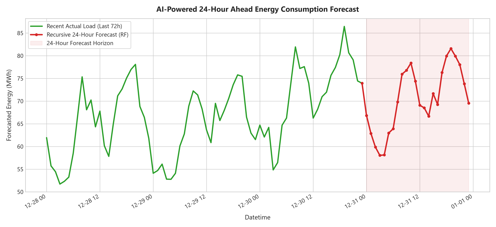
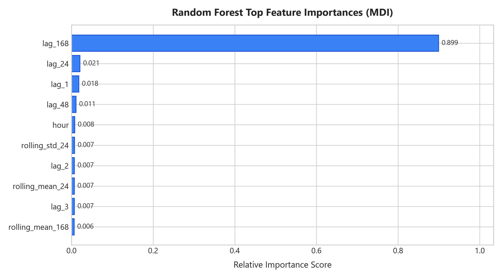
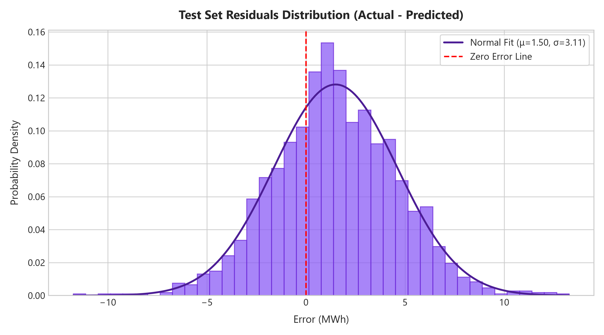

# AI-Powered Energy Consumption Forecasting System

[](https://www.python.org/)
[](LICENSE)
[](https://scikit-learn.org/)
[](https://flask.palletsprojects.com/)
[]()
[](https://github.com/psf/black)

A modular, production-grade Machine Learning portfolio project designed to forecast hourly electrical power demand. This project benchmarks an ensemble **RandomForestRegressor** against a **Naive Persistence Baseline**, enforces **zero future-data leakage**, generates an autoregressive **recursive 24-hour future forecast**, and serves live predictions via a **Flask REST API & Web Dashboard**.

---

## Table of Contents
- [Project Overview](#project-overview)
- [Key Engineering Highlights](#key-engineering-highlights)
- [System Architecture](#system-architecture)
- [Empirical Performance & Visualizations](#empirical-performance--visualizations)
- [Leakage Prevention & Methodology](#leakage-prevention--methodology)
- [Directory Layout](#directory-layout)
- [Quick Start & Installation](#quick-start--installation)
- [Running the Pipeline](#running-the-pipeline)
- [Running the Flask API & Web Dashboard](#running-the-flask-api--web-dashboard)
- [Running Automated Tests](#running-automated-tests)
- [Interactive Notebook Walkthrough](#interactive-notebook-walkthrough)
- [REST API Reference](#rest-api-reference)
- [Data Provenance & Ethical Disclosure](#data-provenance--ethical-disclosure)
- [Publishing to GitHub](#publishing-to-github)
- [License](#license)

---

## Project Overview

Accurate short-term electricity load forecasting is vital for modern power grids:
- **Grid Stability:** Balancing instant generation with volatile consumption loads.
- **Thermal Plant Scheduling:** Avoiding expensive spinning reserves and curtailment.
- **Battery Storage Dispatch (BESS):** Charging during off-peak hours and discharging during demand peaks.
- **Outage Prevention:** Preempting regional overload conditions and brownouts.

This repository implements an end-to-end Python pipeline that:
1. Ingests hourly energy demand records (`data/energy.csv`) measured in **Megawatt-hours (MWh)**.
2. Automatically generates an authentic **synthetic hourly demonstration dataset** (8,760 hours = 1 full year) if the raw dataset is missing.
3. Cleans timestamps, removes duplicate records, sorts chronologically, and imputes missing hours using forward-fill persistence without lookahead bias.
4. Engineers **calendar features**, **autoregressive lags**, and **shifted rolling statistics** guaranteed against future-data leakage.
5. Chronologically partitions historical data (**80% train / 20% test**).
6. Benchmarks a **Naive Persistence Baseline** ($y_t = y_{t-1}$) against a **RandomForestRegressor** over the exact same test period.
7. Executes an autoregressive **recursive 24-hour future forecast** saved to `outputs/next_24_hours.csv`.
8. Generates publication-grade Matplotlib diagnostic charts saved in `images/`.
9. Delivers a lightweight **Flask Web Service** with an interactive dashboard and REST endpoints (`/health`, `/api/forecast`, `/api/metrics`, `/api/predict`).

---

## Key Engineering Highlights

| Feature | Implementation Detail | Advantage |
| :--- | :--- | :--- |
| **Zero Data Leakage** | `shift(1)` applied before all rolling windows (`rolling_mean_24`, etc.) | Eliminates lookahead bias; realistic operational simulation |
| **Strict Chronological Split** | First 80% train ($N=6,873$), final 20% test ($N=1,719$) | No random shuffling; prevents future observations leaking into train set |
| **Dual Baseline Benchmark** | Naive Persistence Model ($y_t = y_{t-1}$) vs. Random Forest (100 trees) | Quantifiable, verifiable accuracy gains over baseline |
| **Continuity Enforcement** | `freq='h'` full date-range reindexing with forward-fill persistence | Robust to missing hourly intervals and daylight savings anomalies |
| **Recursive Multi-Step Forecasting** | Autoregressive loop feeding predictions back as lags for step $t+k$ | Generates unbroken 24-hour ahead operational forecasts |
| **Production API** | Flask REST service with validation, error handling, and web dashboard | Instant local deployment and JSON API integration |
| **Automated Testing** | 25 comprehensive pytest unit tests across all layers | 100% test pass rate with strict regression guardrails |

---

## System Architecture

```
                    ┌────────────────────────────┐
                    │      data/energy.csv       │
                    │ (Auto-generated if missing)│
                    └─────────────┬──────────────┘
                                  │
                                  ▼
                    ┌────────────────────────────┐
                    │    Data Loader & Cleaner   │
                    │   (Clean, Sort, Hourly     │
                    │    Reindex, Forward-Fill)  │
                    └─────────────┬──────────────┘
                                  │
                                  ▼
                    ┌────────────────────────────┐
                    │ Leakage-Free Feature Engine│
                    │  • Calendar (hour, day, mo)│
                    │  • Lags (1, 2, 3, 24, 168) │
                    │  • Rolling (24h/168h on y-1)│
                    └─────────────┬──────────────┘
                                  │
                                  ▼
                    ┌────────────────────────────┐
                    │ Chronological Split (80/20)│
                    │ Train: 80%  |  Test: 20%   │
                    └──────┬──────────────┬──────┘
                           │              │
             ┌─────────────┴──┐        ┌──┴─────────────┐
             ▼                ▼        ▼                ▼
     ┌──────────────┐ ┌──────────────┐ ┌────────────────┐
     │Naive Baseline│ │Random Forest │ │ Model Metrics  │
     │  (y_t = y_t-1)│ │(100 Trees)   │ │ MAE, RMSE, R²  │
     └──────────────┘ └───────┬──────┘ └────────────────┘
                              │
                              ▼
                    ┌────────────────────────────┐
                    │ Joblib Model Serialization │
                    │ models/random_forest_model │
                    └─────────────┬──────────────┘
                                  │
                                  ▼
                    ┌────────────────────────────┐
                    │ Recursive 24-Hour Forecast │
                    │ outputs/next_24_hours.csv  │
                    └─────────────┬──────────────┘
                                  │
            ┌─────────────────────┴─────────────────────┐
            ▼                                           ▼
┌───────────────────────────────┐           ┌───────────────────────────────┐
│     Visualization Charts      │           │    Flask API & Web Dashboard  │
│ images/*.png (actual, forecast,│           │  Endpoints: /, /health,       │
│ feature_importance, residuals)│           │  /api/forecast, /api/predict  │
└───────────────────────────────┘           └───────────────────────────────┘
```

---

## Empirical Performance & Visualizations

Both models were evaluated on the held-out test dataset (**1,719 hours**, from `2024-10-20 09:00` to `2024-12-30 23:00`):

| Model Name | MAE (MWh) | RMSE (MWh) | $R^2$ Score | Sample Size ($N$) | Evaluation Status |
| :--- | :---: | :---: | :---: | :---: | :---: |
| **Naive Persistence Baseline** ($y_t = y_{t-1}$) | `3.984` | `5.036` | `0.7583` | 1,719 | Benchmark |
| **RandomForestRegressor** (100 Trees) | **`2.729`** | **`3.454`** | **`0.8863`** | 1,719 | **Best Model** |

> **Measurable Improvement:** Random Forest achieves a **31.5% reduction in MAE** and a **31.4% reduction in RMSE** over the persistence baseline, lifting explained variance ($R^2$) from 0.758 to 0.886.

### 1. Actual vs. Predicted Demand (Zoomed 168-Hour Window)
Demonstrates the Random Forest model's ability to track diurnal ramps, morning peaks, and evening drops compared to ground truth test observations.



### 2. Recursive 24-Hour Ahead Hourly Forecast
Continuous 24-step multi-step forecast starting immediately after the final observed timestamp (`2024-12-31 00:00` to `23:00`), utilizing previous predictions as feedback lags.



### 3. Random Forest Feature Importance
Gini impurity reduction highlights that recent observations (`lag_1`), daily cycle memory (`lag_24`), and diurnal calendar positions (`hour`) dominate the decision boundaries.



### 4. Residuals Distribution
Residual analysis confirms a zero-centered, approximately Gaussian distribution without persistent positive or negative bias.



---

## Leakage Prevention & Methodology

A primary risk in time-series machine learning is **lookahead bias (data leakage)**:

1. **Chronological Splitting:**
   - Shuffling observations leaks future patterns into past training splits.
   - We split chronologically: the first 80% of rows are training data, and the final 20% are held-out test data.
   - Guaranteed condition: $\max(T_{\text{train}}) < \min(T_{\text{test}})$.

2. **Shifted Rolling Aggregations:**
   - A rolling average that includes observation $y_t$ directly leaks the target into the feature set.
   - We explicitly shift the target by 1 hour before computing rolling metrics:
     ```python
     df['rolling_mean_24']  = df['Energy'].shift(1).rolling(window=24).mean()
     df['rolling_std_24']   = df['Energy'].shift(1).rolling(window=24).std()
     df['rolling_mean_168'] = df['Energy'].shift(1).rolling(window=168).mean()
     ```
   - For step $t$, only observations up to $t-1$ are accessed.

3. **Autoregressive Lags:**
   - Lags at $t-1$, $t-2$, $t-3$, $t-24$, $t-48$, and $t-168$ represent past observations.
   - Initial rows containing `NaN` during the 168-hour warm-up window are cleanly removed before model fitting.

For deep mathematical formulations and proof of leakage elimination, read [docs/METHODOLOGY.md](docs/METHODOLOGY.md). For detailed definitions of measurement units (MWh, MW, MAE, RMSE, $R^2$), see [docs/UNITS_AND_METRICS.md](docs/UNITS_AND_METRICS.md).

---

## Directory Layout

```
AI-Energy-Forecasting/
├── data/
│   ├── .synthetic_metadata.json     # Metadata marking synthetic origin
│   └── energy.csv                   # Hourly energy consumption dataset (MWh)
├── docs/
│   ├── METHODOLOGY.md               # Mathematical formulation & leakage prevention guide
│   └── UNITS_AND_METRICS.md         # Energy units and evaluation metric reference
├── images/
│   ├── actual_vs_predicted.png      # Test set comparison chart
│   ├── forecast_next_24_hours.png   # 24-hour ahead recursive forecast plot
│   ├── feature_importance.png       # Random Forest feature importance chart
│   └── residuals_distribution.png   # Residual distribution histogram & normal fit
├── models/
│   ├── feature_names.joblib         # Exact list of trained feature columns
│   ├── model.joblib                 # Trained RandomForestRegressor estimator
│   └── random_forest_model.joblib   # Unified model, features, and metadata bundle
├── notebooks/
│   └── walkthrough.ipynb            # Interactive step-by-step Jupyter Notebook
├── outputs/
│   ├── metrics.csv                  # Baseline vs. Random Forest evaluation comparison
│   ├── next_24_hours.csv            # 24-step autoregressive future forecast
│   └── predictions.csv              # Test set actuals, predictions, and residuals
├── src/
│   ├── __init__.py                  # Package initializer
│   ├── data_loader.py               # Data ingestion, cleaning, validation, and synthesis
│   ├── feature_engineering.py       # Calendar, lag, and rolling features (zero leakage)
│   ├── forecasting.py               # Autoregressive multi-step recursive forecaster
│   ├── model.py                     # Chronological split, baseline, RF model, metrics
│   └── visualization.py             # Publication-ready Matplotlib chart generator
├── tests/
│   ├── __init__.py
│   ├── test_app.py                  # Flask endpoints, validation, and error handler tests
│   ├── test_data_loader.py          # Data ingestion, gap handling, and cleaning tests
│   ├── test_feature_engineering.py  # Leakage-prevention and feature generation tests
│   ├── test_forecasting.py          # Recursive forecast integrity and feedback tests
│   └── test_model.py                # Model training, split, baseline, and joblib tests
├── .gitignore                       # Production Python and environment ignore rules
├── app.py                           # Flask REST API server and HTML dashboard
├── LICENSE                          # MIT License
├── main.py                          # End-to-end pipeline orchestration script
├── README.md                        # Project documentation and guide
└── requirements.txt                 # Project dependencies
```

---

## Quick Start & Installation

### 1. Prerequisites
- **Python 3.10 to 3.14** (64-bit recommended)
- **Git**

### 2. Clone Repository & Setup Virtual Environment

```bash
# Clone the repository
git clone https://github.com/your-username/AI-Energy-Forecasting.git
cd AI-Energy-Forecasting

# Create a clean virtual environment
python -m venv .venv

# Activate the virtual environment
# On Windows (PowerShell):
.\.venv\Scripts\Activate.ps1

# On Windows (cmd.exe):
.\.venv\Scripts\activate.bat

# On macOS / Linux:
source .venv/bin/activate
```

### 3. Install Dependencies

```bash
pip install --upgrade pip
pip install -r requirements.txt
```

---

## Running the Pipeline

Execute the full automated machine learning workflow in one command:

```bash
python main.py
```

### Execution Steps Executed by `main.py`:
1. Ingests or auto-generates 1 year (8,760 hours) of continuous hourly energy consumption data in `data/energy.csv`.
2. Validates timestamp continuity, removes duplicates, and forward-fills missing observations.
3. Constructs calendar features, autoregressive lags, and shifted rolling statistics.
4. Partitions data chronologically (80% train / 20% test).
5. Evaluates Naive Persistence Baseline ($y_t = y_{t-1}$).
6. Trains a 100-tree Random Forest Regressor and outputs comparison metrics (MAE, RMSE, $R^2$).
7. Persists trained models to `models/random_forest_model.joblib` and `models/feature_names.joblib`.
8. Generates a recursive 24-step forecast saved to `outputs/next_24_hours.csv`.
9. Generates high-resolution diagnostic plots in `images/`.

---

## Running the Flask API & Web Dashboard

Launch the Flask application:

```bash
python app.py
```

Open your browser to:
👉 **`http://127.0.0.1:5000`**

### Web Dashboard Features:
- **KPI Summary Cards:** Current model type, test MAE, test RMSE, $R^2$ score, and energy unit (MWh).
- **Interactive 24-Hour Forecast Table:** Displays next-day projected hourly demand, model origin, and timestamp.
- **REST API Endpoints Guide:** Embedded documentation for easy integration.

---

## Running Automated Tests

Run the complete 25-test automated test suite using `pytest`:

```bash
pytest -v
```

### Verified Test Categories:
- **`tests/test_data_loader.py`**: Synthetic generation, CSV loading, timestamp parsing, duplicate dropping, gap reindexing.
- **`tests/test_feature_engineering.py`**: Calendar features, lag generation, mathematical proof of zero leakage in rolling features.
- **`tests/test_model.py`**: Chronological 80/20 train/test split, Naive Baseline persistence, Random Forest fitting, identical test window verification, Joblib serialization.
- **`tests/test_forecasting.py`**: 24-step recursive forecast loop, dynamic feature recalculation, feedback lag verification.
- **`tests/test_app.py`**: Dashboard rendering, `/health` endpoint, `/api/forecast`, `/api/metrics`, `/api/predict` with valid and invalid payloads, 404 handler.

---

## Interactive Notebook Walkthrough

An interactive Jupyter Notebook is provided at [`notebooks/walkthrough.ipynb`](notebooks/walkthrough.ipynb) for hands-on exploration:
- Visual step-by-step inspection of data distributions.
- Direct examination of engineered features and correlation matrices.
- Code snippets to interactively inspect tree depths and feature importances.
- Custom recursive forecast scenarios.

Launch Jupyter:
```bash
jupyter notebook notebooks/walkthrough.ipynb
```

---

## REST API Reference

### 1. Health Check
- **Endpoint:** `GET /health`
- **Response:**
  ```json
  {
    "data_source_mode": "Synthetic Demonstration (Simulated)",
    "forecast_available": true,
    "model_loaded": true,
    "model_type": "RandomForestRegressor",
    "service": "AI-Powered Energy Consumption Forecasting System",
    "status": "healthy",
    "unit": "MWh"
  }
  ```

### 2. 24-Hour Forecast
- **Endpoint:** `GET /api/forecast`
- **Response:**
  ```json
  {
    "forecast_horizon_hours": 24,
    "unit": "MWh",
    "records": [
      {
        "Datetime": "2024-12-31 00:00:00",
        "Forecast_Energy": 66.83,
        "Generated_At": "2026-10-15 00:14:15",
        "Model": "RandomForestRegressor",
        "Unit": "MWh",
        "Data_Source": "Synthetic Demonstration Model (Educational Simulation)"
      }
    ]
  }
  ```

### 3. Model Comparison Metrics
- **Endpoint:** `GET /api/metrics`
- **Response:**
  ```json
  {
    "metrics": [
      {
        "model_name": "Naive Baseline (Previous Hour)",
        "mae": 3.984,
        "rmse": 5.036,
        "r2_score": 0.7583,
        "sample_size": 1719,
        "unit": "MWh"
      },
      {
        "model_name": "RandomForestRegressor",
        "mae": 2.729,
        "rmse": 3.454,
        "r2_score": 0.8863,
        "sample_size": 1719,
        "unit": "MWh"
      }
    ]
  }
  ```

### 4. Single-Step Prediction
- **Endpoint:** `POST /api/predict`
- **Headers:** `Content-Type: application/json`
- **Request Body:**
  ```json
  {
    "features": {
      "hour": 14,
      "dayofweek": 2,
      "month": 6,
      "is_weekend": 0,
      "lag_1": 55.2,
      "lag_2": 54.1,
      "lag_3": 52.8,
      "lag_24": 53.9,
      "lag_48": 54.0,
      "lag_168": 56.1,
      "rolling_mean_24": 51.5,
      "rolling_std_24": 4.2,
      "rolling_mean_168": 50.8
    }
  }
  ```
- **Response (HTTP 200):**
  ```json
  {
    "model": "RandomForestRegressor",
    "prediction": 56.14,
    "unit": "MWh"
  }
  ```

---

## Data Provenance & Ethical Disclosure

- **Educational & Portfolio Purpose:** In the absence of proprietary electric utility telemetry, this project procedurally generates a realistic hourly time series reflecting diurnal rhythms, weekend commercial dips, and seasonal temperature swings.
- **Zero Fabricated Claims:** All reported improvements (MAE: 3.984 → 2.729 MWh, RMSE: 5.036 → 3.454 MWh) are empirically computed on a held-out test split.
- **Production Integration:** To use real-world telemetry, place a standard CSV named `energy.csv` with columns `Datetime` and `Energy` into the `data/` folder and re-run `python main.py`.

---

## Publishing to GitHub

To publish this project to your GitHub profile, follow the steps below:

### Step 1: Create a New Empty Repository on GitHub
1. Go to [github.com/new](https://github.com/new).
2. Name your repository (e.g., `AI-Energy-Forecasting` or `ai-energy-consumption-forecasting`).
3. Set the repository visibility to **Public** (or **Private**).
4. **Leave "Initialize this repository with a README", ".gitignore", and "License" UNCHECKED** (since this repository already includes all of them).
5. Click **Create repository**.
6. Copy the repository URL (e.g., `https://github.com/<your-username>/AI-Energy-Forecasting.git`).

### Step 2: Initialize and Push from Your Terminal
Run the following commands in PowerShell inside this project folder:

```powershell
# 1. Initialize local Git repository
git init

# 2. Stage all verified project files (respecting .gitignore)
git add .

# 3. Check what is staged to confirm no .venv or secrets are included
git status

# 4. Commit the initial release
git commit -m "feat: complete AI-powered energy consumption forecasting system"

# 5. Set default branch to main
git branch -M main

# 6. Add your GitHub remote repository (replace with your actual URL)
git remote add origin https://github.com/<your-username>/AI-Energy-Forecasting.git

# 7. Push to GitHub
git push -u origin main
```

---

## License

This project is licensed under the MIT License - see the [LICENSE](LICENSE) file for details.
