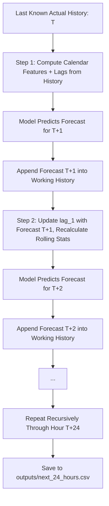

# AI-Powered Energy Consumption Forecasting: Methodology & Architecture

This document provides a comprehensive mathematical and engineering description of the forecasting methodology implemented in this repository.

---

## 1. Time-Series Problem Formulation

Energy forecasting is formulated as an autoregressive regression task:

$$\hat{y}_{t} = f\Big(t, \mathbf{y}_{<t}, \mathbf{x}_t\Big)$$

Where:
- $\hat{y}_t$: Predicted energy consumption at hour $t$ (in **Megawatt-hours, MWh**).
- $\mathbf{y}_{<t}$: Historical observations strictly prior to hour $t$ ($y_{t-1}, y_{t-2}, \dots$).
- $\mathbf{x}_t$: Deterministic calendar/temporal context (hour, day of week, month, weekend indicator).
- $f(\cdot)$: Non-linear function modeled by a `RandomForestRegressor`.

---

## 2. Preventing Future Data Leakage (Lookahead Bias)

Time series data requires strict guardrails against data leakage:

### A. Chronological Splitting
- **Never randomly shuffle** time-series data. Random shuffling allows the model to learn patterns from future hours to predict past hours, yielding falsely optimistic evaluation metrics that collapse in production.
- This project partitions the data chronologically: the first **80%** of records are allocated to training, and the final **20%** are reserved for out-of-sample testing.
- We formally verify: $\max(T_{\text{train}}) < \min(T_{\text{test}})$.

### B. Leakage-Free Rolling Statistics
When computing rolling window statistics (e.g., 24-hour moving average), including the current observation $y_t$ in the window leaks the target value directly into the feature set.
In this implementation, the target variable is **shifted by 1 hour** before computing the rolling window:

$$\text{rolling\_mean\_24}(t) = \frac{1}{24} \sum_{k=1}^{24} y_{t-k}$$

$$\text{rolling\_std\_24}(t) = \sqrt{\frac{1}{23} \sum_{k=1}^{24} \left( y_{t-k} - \text{rolling\_mean\_24}(t) \right)^2}$$

At step $t$, the rolling aggregation accesses observations up to $t-1$ only.

---

## 3. Feature Engineering Catalog

| Feature Name | Type | Description | Rationale |
| :--- | :--- | :--- | :--- |
| `hour` | Calendar | Integer `[0, 23]` | Captures the diurnal curve (morning/evening peaks, night troughs). |
| `dayofweek` | Calendar | Integer `[0, 6]` (0 = Monday) | Accounts for differences between commercial workdays and weekends. |
| `month` | Calendar | Integer `[1, 12]` | Captures annual seasonality (summer AC cooling, winter heating). |
| `is_weekend` | Calendar | Binary `{0, 1}` | Explicit indicator for Saturday and Sunday load reduction. |
| `lag_1` | Autoregressive | $y_{t-1}$ (1 hour ago) | Captures immediate autocorrelation / persistence. |
| `lag_2` | Autoregressive | $y_{t-2}$ (2 hours ago) | Captures short-term rate-of-change momentum. |
| `lag_3` | Autoregressive | $y_{t-3}$ (3 hours ago) | Captures multi-hour momentum. |
| `lag_24` | Autoregressive | $y_{t-24}$ (24 hours ago) | Daily seasonal lag (same hour yesterday). |
| `lag_48` | Autoregressive | $y_{t-48}$ (48 hours ago) | Two-day seasonal lag. |
| `lag_168` | Autoregressive | $y_{t-168}$ (168 hours ago) | Weekly seasonal lag (same hour last week). |
| `rolling_mean_24` | Rolling | Mean of $y_{t-24 \dots t-1}$ | Moving baseline load over the past 24 hours. |
| `rolling_std_24` | Rolling | Std of $y_{t-24 \dots t-1}$ | Volatility and dispersion over the past 24 hours. |
| `rolling_mean_168` | Rolling | Mean of $y_{t-168 \dots t-1}$ | Weekly trend and secular drift indicator. |

---

## 4. Benchmark: Naive Persistence Baseline

A common pitfall in machine learning portfolio projects is training complex models without an intuitive baseline.
In time series forecasting, the primary benchmark is the **Naive Persistence Baseline**:

$$\hat{y}_{t}^{\text{baseline}} = y_{t-1}$$

This assumes that energy consumption in the next hour will simply equal consumption in the current hour. The machine learning model (`RandomForestRegressor`) must demonstrate statistically significant error reduction (lower MAE, lower RMSE, and higher $R^2$) to justify model complexity.

---

## 5. Recursive Multi-Step 24-Hour Ahead Forecasting

To forecast 24 hours into the future where ground truth values are unavailable:

1. **Step $t+1$**: Features are constructed using known historical observations up to $T$. The model predicts $\hat{y}_{T+1}$.
2. **Step $t+2$**: The predicted $\hat{y}_{T+1}$ is fed back into the feature pipeline as `lag_1`. Lags shift down (`lag_2` becomes the observation at $T$), and rolling statistics dynamically incorporate $\hat{y}_{T+1}$.
3. This process continues recursively through all 24 hours, yielding a complete, continuous forecast saved to `outputs/next_24_hours.csv`.
